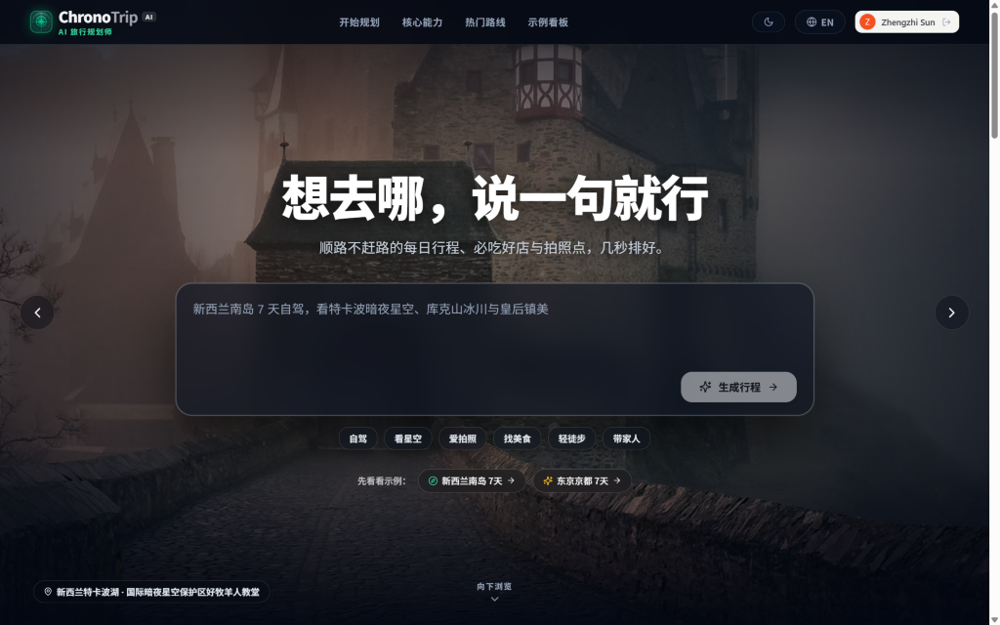
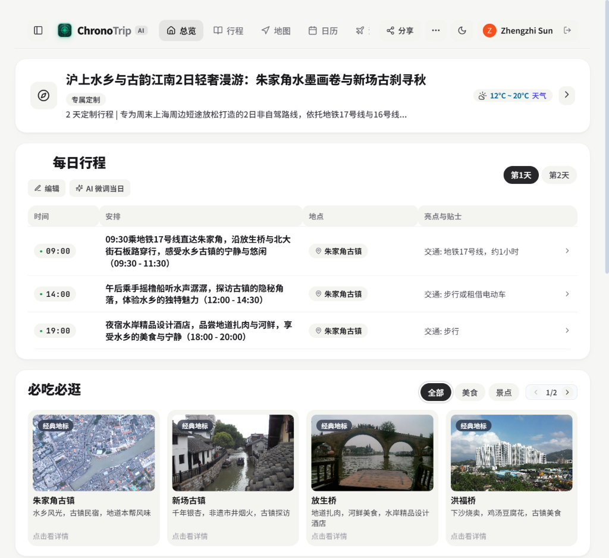
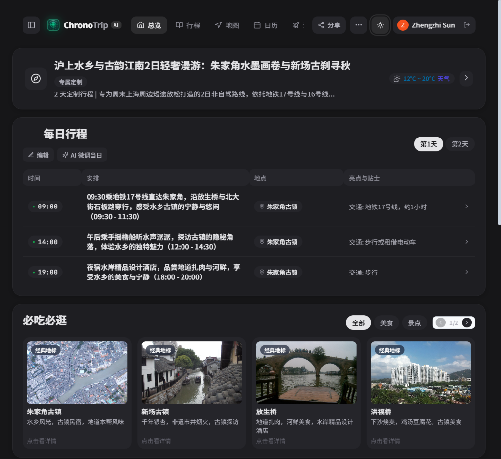
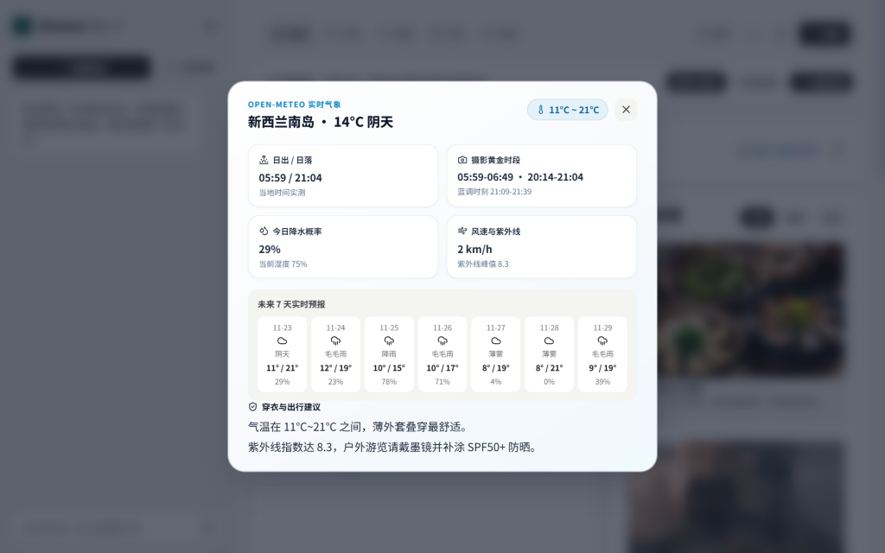

# ChronoTrip AI · 时空智旅

**一句话生成顺路不赶路的专属旅行方案 — 每日动线、地道美食、摄影机位、实时气象与行前清单一次排好**

 

👉 **立即访问在线应用：[https://trip.hisunalan.me](https://trip.hisunalan.me)**

---

## 产品简介

**ChronoTrip AI（时空智旅）** 是一款面向自由行与自驾玩家的智能旅行规划 Web 应用。只需用自然语言描述目的地、天数与出行偏好（例如「周末上海周边 2 天非自驾古镇漫游」或「新西兰南岛 7 天自驾看星空与冰川」），系统即可自动生成完整可落地的结构化旅行看板与可打印路书。

> **说明**：本仓库为 **ChronoTrip AI 产品展示与在线访问入口仓**，仅提供产品介绍、功能概览与更新动态，不公开源代码及内部实现细节。欢迎直接访问线上网址体验，或在 Issues 中提交体验建议与目的地反馈。

---

## 核心功能

| 模块 | 能力介绍 |
| :--- | :--- |
| **一句话多阶段智能规划** | 自动拆解路线大纲、每日早中晚顺路动线、交通接驳、美食地标与行前预算，全程实时可视化展示思考脉络。 |
| **交互式行程总览看板** | 卡片化呈现每日安排、必吃必逛（严格区分「特色美食」与「经典地标」）、摄影机位指南与费用预估。 |
| **行内编辑 & 单日 AI 微调** | 支持手动增删修改任意节点，或针对某一天输入自然语言指令进行局部 AI 重排，无需重跑整趟行程。 |
| **实时气象与摄影光影雷达** | 自动获取目的地实时气温、湿度、降水概率、风速、紫外线峰值、未来 7 天逐日预报及日出日落摄影黄金/蓝调时段。 |
| **地图路线与日历视图** | 支持按天切换查看景点动线分布与日历排期，一键导出标准 `.ics` 日程文件导入手机日历。 |
| **行前清单 & 账单 AA 分摊** | 内置智能打包核对清单、核心预订提醒以及多人同行开销记账与自动 AA 分摊结算。 |
| **一键分享与打印路书** | 支持生成公开只读分享链接发送给同行旅伴，也支持一键排版导出可打印的便携 PDF 路书。 |
| **多端账号云端同步** | 支持 Google、GitHub 与邮箱登录，个人行程档案与旅行偏好自动云端漫游；支持中英双语与深/浅双色主题切换，全面适配桌面与移动端竖屏。 |

---

## 界面预览

### 1. 沉浸式灵感首页

### 2. Bento 行程总览看板（浅色暖白 / 深色炭灰双主题）

### 3. 目的地实时气象与摄影黄金时刻雷达

---

## 快速体验

1. 打开浏览器访问：**[https://trip.hisunalan.me](https://trip.hisunalan.me)**
2. 无需注册即可直接浏览内置精选示例行程看板、实时气象、路线地图与日历视图。
3. 使用 Google / GitHub 或邮箱登录后，即可输入任意全球目的地生成专属定制行程、云端保存档案并一键分享给朋友。

---

## 反馈与联系

如果你在使用过程中遇到任何问题，或有希望新增的目的地与功能建议，欢迎在本仓库提交 [Issue](../../issues)。

---

## 版权声明

本项目为个人独立维护的闭源产品，保留所有权利（All Rights Reserved）。详见 [LICENSE](./LICENSE)。
